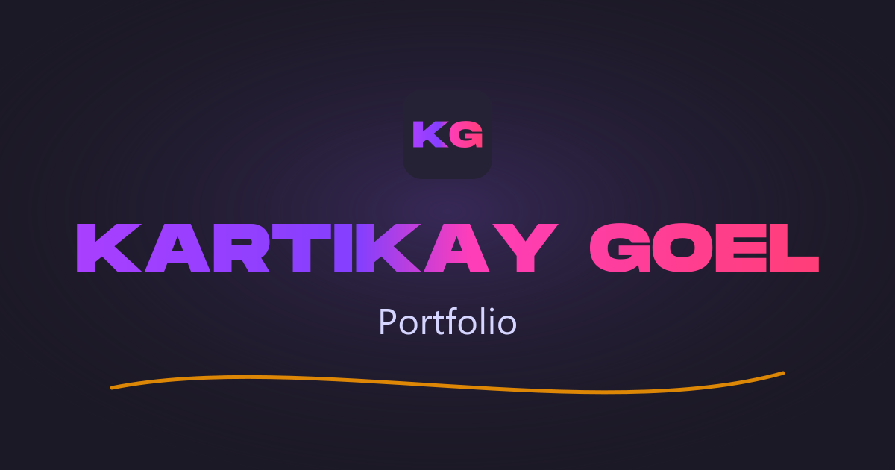

# Kartikay Goel – Portfolio & Blog

My personal portfolio and blog, built with SvelteKit and Sanity CMS.

**Live site:** https://blogout.netlify.app



## Features


- **Responsive layout**: sidebar nav on desktop, bottom tab bar on mobile, auto-hiding header. 

- **Featured post** on the blog home + a 'latest-posts' grid and a "browse categories" strip

- **Categories** with per-category colour, icon, and cover image, and an explore page for each

- **Search** across title, description, and tags via GROQ `match`

- **Save for later**, stored in `localStorage`, with its own 'saved-posts' page

- **Markdown rendering** with `marked` and `highlight.js` (line numbers, copy button, language label, custom headings, links, images, `^sup^`, `~sub~`, `==mark==`, `++ins++`)

- **Contact form** submitting to Formspree, with inline validation

- **Dynamic sitemap** at `/sitemap.xml` generated from Sanity content

- **Other Small features** such as a Reading progress bar and estimated read time per article, Share button using the Web Share API, with clipboard fallback and toast, Low-quality image placeholders (Sanity LQIP) with lazy loading

## Structure

```
src/
├── lib
├── routes
│   ├── about
│   ├── article
│   ├── blogs
│   │   ├── explore
│   │   ├── saved
│   │   └── search
│   ├── contact
│   └── sitemap.xml
└── styles
studio/
```


## Content model

**blog**: `title`, `description`, `category` (ref), `slug`, `featuredImage` (with `source`), `body` (markdown), `tags[]`, `date`, `featured`

**category**: `name`, `color` (`"r, g, b"`), `image`, `icon` (Iconify name, e.g. `bx:code-alt`)


## Tech stack

| Layer | Tech |
|---|---|
| Framework | SvelteKit|
| Styling | SCSS |
| CMS | Sanity v3 |
| Icons | Iconify |
| Hosting | Netlify |

## Blog posts

Posts are loaded from a Sanity project: by default the original project this site was forked with. Set `PUBLIC_SANITY_PROJECT_ID` in Netlify (Project configuration → Environment variables) to use your own instead. The editor in `studio/` reads the same ID from `SANITY_STUDIO_PROJECT_ID`.

## Credits

Forked from [nanohills/personal-blog-site](https://github.com/nanohills/personal-blog-site).

## License

[MPL 2.0](LICENSE)
